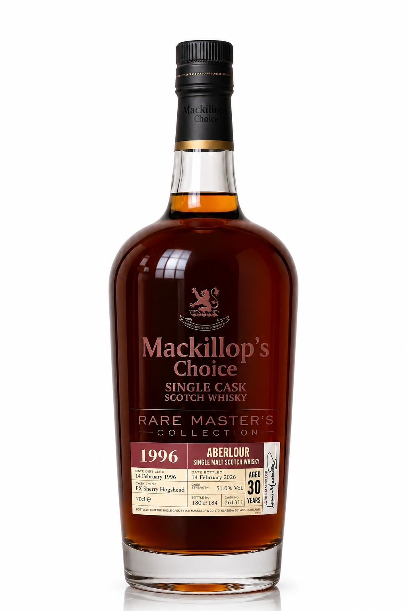
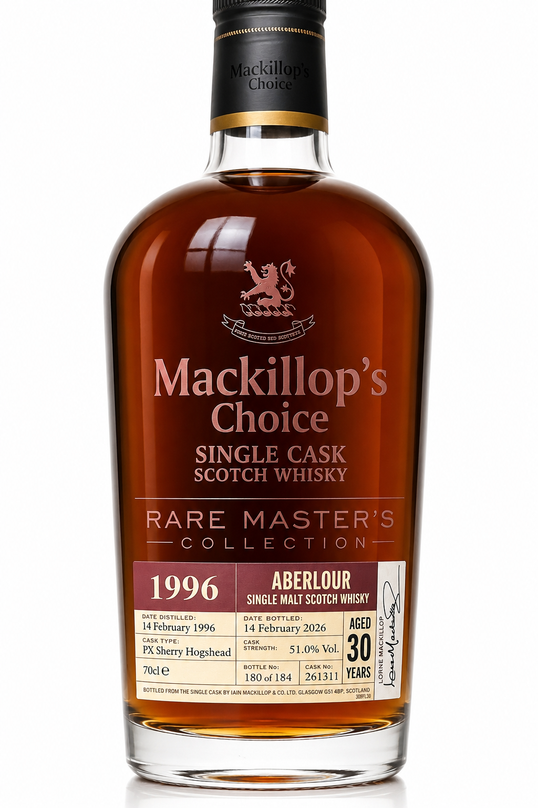
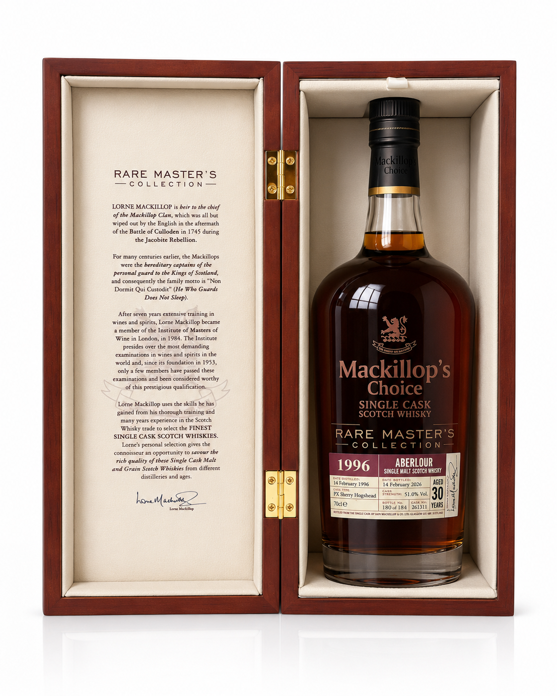

# 威熏邑境自媒体内容生成系统 · WXYJ Content System

**威熏邑境自媒体内容生成系统（WXYJ Content System）是威熏邑境品牌专属的 Codex Skill，围绕“马克瑞普之选 · 单桶苏格兰威士忌”，提供小红书图文、抖音短视频、视频号内容和电商商品素材的策划、生产指引、审核与归档。**

系统把产品知识、包装关系、参考图片、选题、文案、图像提示词、视频分镜和发布检查组织在同一个工作流中：从一个母题出发，分别交付适合各平台的画面与文案，并用内容台账和真实表现数据支持后续优化。

> WXYJ Content System is a brand-specific Codex Skill for whisky content planning and production across Xiaohongshu (RED), Douyin, WeChat Channels and ecommerce. It combines product facts, visual references, image prompts, video storyboards, quality checks and content archives for Mackillop's Choice single cask Scotch whisky.

| 项目 | 说明 |
| --- | --- |
| Skill ID | `wxyj-content-system` |
| 服务品牌 | 威熏邑境 |
| 当前核心商品 | 马克瑞普之选 · 单桶苏格兰威士忌 |
| 主要平台 | 小红书、抖音、视频号；兼顾电商、私信、企微及品鉴活动承接 |
| 主要用户 | 品牌运营、内容策划、视觉创作者、销售与品鉴活动团队 |
| 使用入口 | [SKILL.md](SKILL.md) · [开始使用](docs/getting-started.md) · [GitHub 仓库](https://github.com/ifeihong/wxyj-content-system) |

## 目录

- [功能与交付](#功能与交付)
- [产品知识与节日礼包](#产品知识与节日礼包)
- [内置参考素材](#内置参考素材)
- [内容生产与审核流程](#内容生产与审核流程)
- [安装与快速使用](#安装与快速使用)
- [内容包与项目结构](#内容包与项目结构)
- [常见问题](#常见问题)
- [文档与许可](#文档与许可)

## 功能与交付

### 一题三做：小红书、抖音与视频号

三个平台共享产品事实与内容母题，分别设计开头、结构、语气和行动引导。每套内容同时提供视觉方案和匹配的发布文案，避免只交图片、缺少正文或把同一稿机械复制到不同平台。

| 使用场景 | 主要交付 |
| --- | --- |
| 小红书图文 | 选题、采用标题与备选标题、按信息量安排的页数、逐页画面与提示词、正文、标签、首评、CTA及审核记录 |
| 抖音短视频 | 标题、3秒钩子、逐镜分镜、旁白与字幕方案、封面文案、视频简介、标签与置顶评论 |
| 视频号内容 | 标题、5秒观看理由、完整叙事分镜、视频描述、标签、首评与朋友圈转发文案 |
| 电商商品素材 | 原生1:1商品缩略图、详情长图信息结构、商品文案、产品参考组合及独立验收卡 |
| 节日礼赠内容 | 礼包包装层级、送礼场景、开包与开盒分镜、套装陈列和配套发布文案 |
| 运营与转化承接 | 评论、私信、企微、店铺与品鉴活动的内容建议和话术 |

### 产品视觉一致性

系统为完整酒瓶、酒标、木质礼盒和节日皮包分配不同参考职责。完整酒瓶使用正面几何母版与尺寸校准图，酒标近景负责局部字段，礼盒参考负责开合与合页结构，风格参考负责色彩、光线和材质氛围。

- 小红书图片采用原生3:4；电商主缩略图采用原生1:1。
- 视频默认原生9:16；用户明确要求3:4时，按当次计划统一生产与验证。
- 文字准确度、文字区洁净度、产品比例、边缘融合和手机可读性分别验收。
- 同一套内容分配不同机位与主要事实，减少重复构图及重复信息。

### 视频分镜、外部生成与可编辑剪辑

抖音和视频号可共用 `video-master/` 母版。默认协作路径为：Agent准备静态镜头和Seedance参考帧 → 输出逐镜任务卡与提示词 → 用户通过外部平台生成并回传视频 → 验收素材 → 交给ChatCut制作可编辑剪辑、字幕、声音与导出。

系统提供镜头任务包、回传检查、连续运动计划、旁白与音乐衔接要求，以及实际成片和工程证据登记。视频生成与剪辑需要相应工具和运行环境；安装Skill不等于已接通全部服务。

### 内容去重与数据复盘

通过创意台账比对近期主题、事实、首图机位、钩子和版式组合。效果分析优先读取真实平台数据，每条候选内容登记一个实验变量、假设和成功指标。发布不足48小时的数据只作观察；少于10条可比成熟内容时只形成假设，不据单条表现淘汰整个栏目。

## 产品知识与节日礼包

### 当前核心商品

**Mackillop's Choice（马克瑞普之选）是品牌，ABERLOUR（亚伯乐）是酒厂，1996年是蒸馏年份，30年是酒龄。** 正式商品名称为“马克瑞普之选 · 单桶苏格兰威士忌”，这些身份字段不能互相替代。

| 字段 | 产品知识库记录 |
| --- | --- |
| 酒厂 / 产区 | ABERLOUR（亚伯乐）/ 苏格兰斯佩塞 |
| 入桶 / 装瓶日期 | 1996年2月14日 / 2026年2月14日 |
| 酒龄 / 容量 | 30年 / 700毫升 |
| 桶型 / 桶号 | PX Sherry Hogshead / 261311 |
| 酒精度 | 51% |
| 该桶总装瓶数 | 184瓶；不代表当前库存 |
| 当前标准样瓶号 | 180 of 184 |

产品事实、包装品鉴词与品牌故事分别维护，发布前仍需核对真实酒标和运营方文件。价格、库存与销售条件按当次确认，不从参考图推断。

### 节日手提皮革包礼包

**红色手提皮革包 → 木质礼盒 → 威士忌酒瓶。** 用户已确认：皮包内放置木质礼盒，木盒内放置“马克瑞普之选 · 单桶苏格兰威士忌”酒瓶。这是现有酒款的节日礼赠包装组合。


皮包参考特征包括红色皮革纹理、双提手、翻盖、圆形金属扣与叶形吊饰。图中标注长30 cm × 深17 cm × 包身高14 cm，高度不含提手；这只是参考图标注，不是实测或内腔尺寸证据。

制作礼包图与开包分镜时，保留三层容纳关系，不将酒瓶直接装进皮包。开包露木盒须结合木盒参考，开盒露酒瓶须继续使用酒瓶几何参考。未确认真皮或具体皮料、内衬结构、礼包售价、赠送条件及是否随所有订单附送，不自行补写。

## 内置参考素材

仓库内置 **23张核心AIGC产品参考图 + 1张用户提供的节日皮包补充参考图**，共24张PNG素材。

| 素材类别 | 数量 | 参考用途 |
| --- | --- | --- |
| 酒瓶 | 5 | 正面、左右45°、背面及酒标近景 |
| 酒瓶尺寸示意图 | 1 | 各高度投影宽度、纵向分段和轮廓曲线校准 |
| 木质礼盒 | 10 | 正背面、透视、品鉴标签、开盒与半开结构 |
| 白色外包装 | 7 | 外包装身份、角度与结构 |
| 红色节日皮包展示板 | 1 | 皮包多角度外观、五金细节和图示尺寸 |

<p>
  
  
  
</p>

- [浏览全部参考图](assets/products/mackillops-choice-aberlour-1996/reference-images/)
- [资产清单、来源、用途与SHA-256](assets/products/mackillops-choice-aberlour-1996/asset-manifest.json)
- [视觉素材选取规则](references/visual-asset-library.md)
- [产品视觉一致性与人工验收](references/product-visual-consistency-system.md)

原23张为AIGC参考图；皮包展示板的拍摄或生成方式未核验，单独登记于 `supplementary_assets`。酒瓶尺寸图是按实物照片比例推算的几何参考。这些素材用于身份、结构和视觉控制，不替代真实酒标、实物照片、进口或溯源文件，也不自动授予品牌素材使用权。

## 内容生产与审核流程

1. **明确任务**：确定平台、母题、受众、目标及当次画幅、字幕、运动与声音要求。
2. **读取产品知识**：核对产品事实、包装文案和相关参考素材，记录证据缺口。
3. **策划内容**：结合近期台账与成熟数据，分配每页或每镜的主要事实和视觉职责。
4. **创建内容包**：保存简报、来源、创意记录、平台文案、提示词及分镜。
5. **生产与验收**：按当前环境调用图像或视频工具，分别检查产品、文字、画幅、声音和连续性。
6. **登记最终交付**：通过预检后，在交付索引中列明最终素材、文案和对应工程；发布后更新台账。

文件存在、哈希一致和脚本通过，只能证明相应结构检查通过。产品外观、事实表达及成片视听质量仍需实际审阅，不能用计划文件代替最终成片验收。

## 安装与快速使用

### 安装

需要Codex或兼容Agent Skills的运行环境。仓库根目录就是Skill根目录；将完整仓库放入该环境的Skills目录，保留参考图、脚本和模板。

```powershell
git clone https://github.com/ifeihong/wxyj-content-system.git
```

Windows默认目录示例：

```text
C:\Users\<用户名>\.codex\skills\wxyj-content-system\SKILL.md
```

实际安装位置以运行环境配置为准。校验脚本需要Python 3.10或更高版本，图片检查需要Pillow，视频元数据检查需要ffprobe。完整安装和既有副本同步方法见[开始使用](docs/getting-started.md)。

### 调用Skill

小红书图文：

```text
使用 $wxyj-content-system，为马克瑞普之选 · 单桶苏格兰威士忌
制作一套小红书图文，按信息量决定页数。
交付图片、采用标题、正文、标签、首评、逐页提示词和QA。
```

节日礼赠套装：

```text
使用 $wxyj-content-system，策划一套节日礼赠内容。
采用内置红色皮革手提包参考图，保持“皮包 → 木质礼盒 → 酒瓶”的包装层级，
提供套装展示方案、配套发布文案和产品视觉验收记录。
```

抖音与视频号：

```text
使用 $wxyj-content-system，围绕这款酒的纪念日主题，
策划一条抖音与视频号共用的竖屏视频母版。
提供逐镜分镜、参考帧、外部Seedance任务包、剪辑与声音方案，
并分别输出两个平台的发布文案。
```

### 创建运行目录与验证

在仓库根目录执行，示例日期按实际任务调整：

```powershell
python scripts/create_content_run.py --root outputs --date 2026-11-24 --slug festive-gift --platforms xiaohongshu
python scripts/validate_product_assets.py
```

电商任务改用 `--platforms ecommerce`；多平台任务可使用 `--platforms xiaohongshu douyin weixin-channels`。

内容完成后，检查对应运行包：

```powershell
python scripts/validate_content_run.py outputs/2026/11/2026-11-24-festive-gift
python scripts/validate_release_preflight.py outputs/2026/11/2026-11-24-festive-gift
```

资产校验覆盖24张已登记参考图及其哈希；运行包和发布预检分别检查目录、文案字段、媒体登记与交付条件。视频另外按任务运行[运动计划检查](scripts/validate_video_motion_plan.py)和[生产计划检查](scripts/validate_video_production_plan.py)。

## 内容包与项目结构

每次任务保存独立运行包，便于修改、交接和复盘：

```text
outputs/年/月/日期-主题/
├── brief.md                 # 当次任务简报
├── sources.md               # 内部来源与事实核验
├── creative-record.json     # 创意与实验记录
├── release-manifest.json    # 媒体及发布状态
├── product-visual-qa.md      # 产品人工验收
├── deliverables.md          # 最终交付索引
├── xiaohongshu/             # 对应平台文案、提示词、QA与媒体
└── video-master/            # 视频任务的分镜、素材、任务卡与剪辑计划
```

平台目录按任务创建；视频原始回传保存在 `incoming/`，验收副本进入 `accepted/`。媒体文件采用日期、平台、主题、页或镜、角色和版本号命名，保留可追踪版本。

| 仓库位置 | 内容 |
| --- | --- |
| [SKILL.md](SKILL.md) | Skill入口、任务路由与交付要求 |
| [references/](references/) | 产品知识、平台策略、视觉规范和复盘规则 |
| [assets/](assets/) | 产品参考图与内容模板 |
| [scripts/](scripts/) | 运行包创建、素材验证、交接与数据分析 |
| [examples/](examples/) | 标准内容与工作流示例 |
| [docs/](docs/) | 安装、交付、命名与合规说明 |
| [tests/](tests/) | 脚本与仓库约定的回归测试 |
| [llms.txt](llms.txt) | 供Agent读取的项目身份与文档导航 |

## 常见问题

### WXYJ Content System是什么？

它是威熏邑境品牌专属的AI内容工作流Skill，将产品知识、视觉参考、平台文案、分镜、审核和归档结合起来，支持当前核心威士忌商品的持续内容生产。

### 支持哪些平台和内容形式？

主要支持小红书图文、抖音短视频、视频号内容，也提供电商缩略图与详情长图的生产规范，以及私信、企微、店铺和品鉴活动的承接建议。

### 能直接生成图片和视频吗？

Skill提供可执行的创作要求、参考素材和交接流程。实际生图、视频生成与剪辑依赖当前Agent可用的工具、服务权限及素材。缺少能力或证据时应说明缺口，不把提示词或分镜称作已完成媒体。

### 小红书是否固定8页，三个平台是否使用同一稿？

小红书按信息量选择页数，通常为3–8页。三个平台共享母题与事实，但分别设计开头、内容结构和CTA；抖音与视频号可共享经过验收的视频母版。

### 节日皮包、木盒和酒瓶是什么关系？

红色手提皮革包是节日外层礼包，内放木质礼盒，木盒内再放威士忌酒瓶。礼包展示应保持这一包装层级；是否随单提供、具体皮料及价格须另行确认。

### 参考图能作为真实商品证据吗？

不能。AIGC参考图和来源未核验的补充图用于视觉一致性；消费者事实仍需真实酒标、实物照片和相关文件支持。总装瓶数也不能当作当前库存。

### 能保证内容涨粉、成交或自动发布吗？

系统提供策划、内容实验、审核与复盘方法，不保证平台效果。生成发布包不等于自动发布，实际发布和外部服务操作取决于当次授权与可用工具。

### 能用于其他威士忌商品吗？

当前默认且主要服务马克瑞普之选 · 单桶苏格兰威士忌。新增产品须先由用户提供并核验产品卡、素材和传播边界，再扩展相关知识与工作流。

## 文档与许可

- [产品事实库](references/product-facts.md)
- [包装品鉴词与品牌故事](references/product-packaging-copy.md)
- [品牌定位与内容比例](references/brand-positioning.md)
- [内容交付标准](docs/content-contract.md)
- [输出目录](docs/output-structure.md)与[文件命名](docs/naming-convention.md)
- [电商资产规范](references/ecommerce-production-system.md)
- [视频生产与剪辑交接](references/agent-image-seedance-chatcut-system.md)
- [内容多样性](references/content-diversity-system.md)与[数据驱动复盘](references/performance-adaptive-system.md)
- [合规说明](docs/compliance.md)与[参与贡献](CONTRIBUTING.md)

代码、模板与公开文档使用Apache-2.0。威熏邑境名称、商标、产品图片、包装设计、授权文件及第三方标识不因代码许可而自动授权。产品参考图片属于受限品牌资产，不适用Apache-2.0；使用范围见 [OPEN_SOURCE.md](OPEN_SOURCE.md) 和 [LICENSE](LICENSE)。
